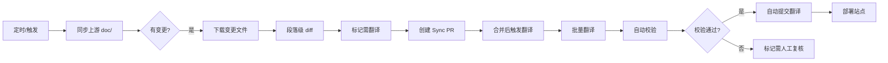

# fmt 中文文档翻译项目

[](https://github.com/jxsword/fmt-zh-docs/actions/workflows/sync-upstream.yml)
[](https://github.com/jxsword/fmt-zh-docs/actions/workflows/validate.yml)
[](https://github.com/jxsword/fmt-zh-docs/actions/workflows/deploy.yml)
[](https://github.com/jxsword/fmt-zh-docs/actions/workflows/test.yml)
[](LICENSE)
[](https://fmt.dev)

> **{fmt} 库官方文档中文翻译版** — 基于 [fmtlib/fmt](https://github.com/fmtlib/fmt) 官方文档翻译，支持增量更新、多版本管理、术语一致性保障。

## 📖 在线阅读

- **最新版**: https://fmt-zh.example.com/latest/
- **v12.2**: https://fmt-zh.example.com/12.2/
- **v11.2 (LTS)**: https://fmt-zh.example.com/11.2/
- **英文原版**: https://fmt.dev/latest/

## 🚀 特性

| 特性 | 说明 |
|------|------|
| **增量翻译** | 段落级 hash 对比，仅翻译变更内容，自动创建 PR |
| **术语一致性** | 上下文感知术语表 + CI 强制校验，消歇同词异义 |
| **代码保护** | 代码块/内联代码/HTML/链接自动保护，绝不误译 |
| **多版本支持** | 同步 fmt.dev 版本结构，支持历史版本回溯与切换 |
| **双语对照** | 悬浮显示原文 + 独立对照页面，便于学习验证 |
| **质量度量** | 自动化指标 + 人工抽检 + 用户反馈闭环 |
| **代码验证** | CI 编译验证所有代码示例，确保可运行性 |

## 📚 文档结构

```
zh/
├── index.md           # 首页：库特性介绍
├── get-started.md     # 快速开始：CMake、安装、构建、各构建系统
├── syntax.md          # 格式字符串语法：替换字段、格式规范、Chrono、范围
├── api.md             # API 参考：核心 API、范围、时间、标准库、编译时、配置等
└── ChangeLog-old.md   # 变更日志（旧版）
```

## 🛠️ 本地开发

### 环境要求

- Python 3.11+
- Git
- (可选) g++/clang/MSVC 用于代码示例验证

### 安装依赖

```bash
git clone https://github.com/jxsword/fmt-zh-docs.git
cd fmt-zh-docs
pip install -r requirements.txt
```

### 常用命令

```bash
# 同步上游文档（首次）
python scripts/sync_docs.py --init

# 同步指定版本
python scripts/sync_docs.py --tag 12.2.0

# 增量同步（从指定 commit）
python scripts/sync_docs.py --since <commit-sha>

# 查看待翻译段落
python scripts/translate_batch.py --dry-run

# 翻译所有/指定文件
python scripts/translate_batch.py --all
python scripts/translate_batch.py --file api.md

# 验证翻译质量
python scripts/validate_translation.py

# 本地预览站点
mkdocs serve
```

## 🤝 贡献指南

欢迎参与翻译！请阅读 [贡献指南](CONTRIBUTING_TRANSLATION.md)。

### 快速上手

1. **Fork 仓库** 到您的 GitHub
2. **认领任务** 在 [翻译看板](docs/translation-board.md) 评论认领
3. **创建分支** `git checkout -b translate/T-001-index`
4. **翻译并验证** 本地运行验证通过
5. **提交 PR** 等待审校合并

### 角色体系

| 角色 | 权限 | 晋升条件 |
|------|------|----------|
| 翻译贡献者 | 认领段落、提交 PR | 注册 GitHub 即可 |
| 审校员 | 审批 PR、维护术语表 | 连续 3 个 PR 通过 |
| 维护者 | 发布版本、管理 CI | 核心团队邀请 |

## 📋 翻译规范

- [翻译风格指南](config/style-guide.md)
- [术语表](config/glossary.yml)
- [质量度量指标](config/quality-metrics.yml)

### 核心原则

1. **代码不翻译** — 代码块、内联代码、API 名称保持原文
2. **术语统一** — 必须使用术语表定义的译名
3. **专业语气** — 使用"您"/"我们"，避免口语化
4. **结构保持** — 标题层级、列表、表格结构不变

## 🏗️ 架构设计

### 增量翻译流水线



### 核心组件

| 组件 | 说明 |
|------|------|
| `scripts/sync_docs.py` | 上游文档同步（支持 main/tag/增量） |
| `scripts/translate_batch.py` | 批量翻译引擎（多 LLM 提供商） |
| `scripts/validate_translation.py` | 翻译质量校验（术语/代码/结构） |
| `scripts/validate_code_examples.py` | 代码示例编译验证 |
| `scripts/translation_memory.py` | 翻译记忆库（语义复用） |
| `.github/workflows/*.yml` | CI/CD 全自动化流水线 |

## 📊 质量指标

| 指标 | 目标 | 当前 |
|------|------|------|
| 术语一致性 | ≥ 99% | - |
| 代码块完整性 | 100% | - |
| 结构完整性 | 100% | - |
| 人工抽检通过率 | ≥ 95% | - |
| 用户满意度 | ≥ 4.5/5 | - |

## 📄 许可证

- **原作品**: MIT License (fmtlib/fmt)
- **翻译作品**: MIT License (本项目)
- 详见 [LICENSE](LICENSE) 和 [LICENSE_TRANSLATION.md](LICENSE_TRANSLATION.md)

## 🙏 致谢

- [fmtlib/fmt](https://github.com/fmtlib/fmt) — 优秀的格式化库
- [mkdocs-material](https://squidfunk.github.io/mkdocs-material/) — 精美的文档主题
- 所有翻译贡献者 — 见 [AUTHORS_TRANSLATION.md](AUTHORS_TRANSLATION.md)

## 📞 联系我们

- **Issues**: [翻译问题报告](https://github.com/jxsword/fmt-zh-docs/issues/new?template=translation-report.yml)
- **Discussions**: [术语讨论、流程建议](https://github.com/jxsword/fmt-zh-docs/discussions)
- **Email**: translation@fmt-zh.example.com

---

<div align="center">
  <strong>基于 fmtlib/fmt 文档翻译 · 遵循 MIT License</strong>
  <br>
  <em>最后更新: 2026-11-18</em>
</div>